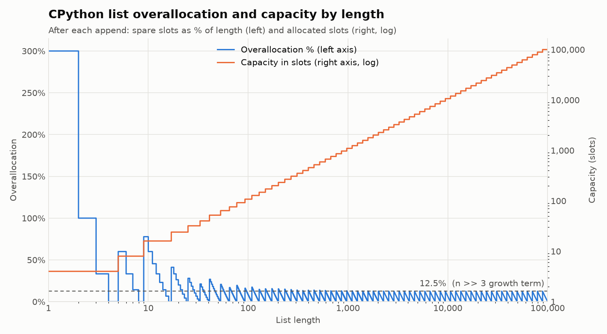
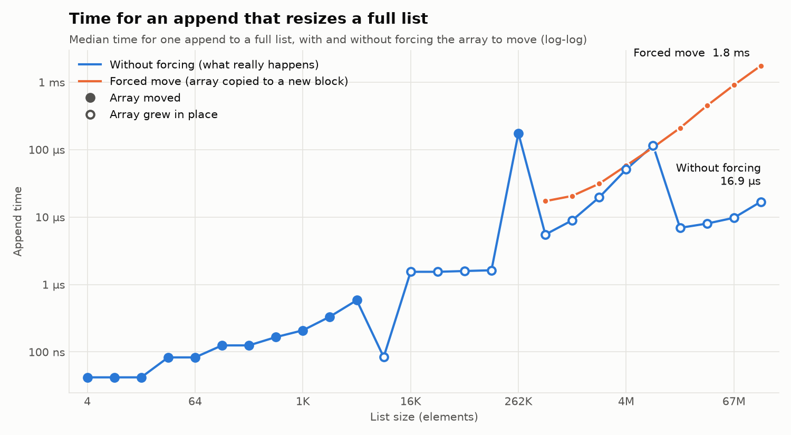

# Introduction

This article contains details regarding the internal representation and mechanicals of a `list` data structure in Python.
It assumes that the reader is already familiar with what a `list` is in Python and how it works. The article doesn't 
go over the basics of what a `list`, how it stores elements, and how to access those elements. 

## Internal representation of a list

A `list` actually stores pointers to its elements in contiguous memory blocks, and not the actual elements. Python stores
the value of elements wherever it can find free memory. The elements' memory addresses need not be in contiguous memory
blocks but the pointers to those memory addresses are always stored in contiguous blocks of memory.

Consider the code below:
```python
import ctypes

t = [1, "test", 2.5]

# Address of the list's pointer array (the ob_item field, 24 bytes into the list object)
array_start = ctypes.c_void_p.from_address(id(t) + 24).value

for i in range(len(t)):
    slot_addr = array_start + i * 8                              # where the pointer lives
    points_to = ctypes.c_void_p.from_address(slot_addr).value    # the pointer's value
    element = ctypes.cast(points_to, ctypes.py_object).value     # follow it to the object

    print(f"slot {i} @ {hex(slot_addr)}  ->  {hex(points_to)}  ->  {element!r}  (id = {hex(id(t[i]))})")
```

After you run this code, you should get an output which should be something like the following:
```
Output:

slot 0 @ 0x1048a2510  ->  0x104db6318  ->  1       (id = 0x104db6318)
slot 1 @ 0x1048a2518  ->  0x10432ba50  ->  'test'  (id = 0x10432ba50)
slot 2 @ 0x1048a2520  ->  0x10429b210  ->  2.5     (id = 0x10429b210)
```

In the output above, we can clearly see that slot 0, 1, and 2 each point to a contiguous block of memory addresses, with
increments of 8 bytes. Those pointers then point to the actual memory addresses where the value of the elements in the `list`
is stored. 

We also confirm this in our output with `{hex(id(t[i]))})`. This last piece of code attempts to print the memory address
by directly referencing the element from the list using `t[i]`, like you normally would when working with elements in a list.
We can see that this address is exactly the same as what we get when we are following the memory address pointer with `hex(points_to)`.

Let's dive a little more deep with the questions below.

### 1. Why are the slot addresses stored in increments of 8 bytes?

That's because of working with a 64-bit machine. The "64" in a "64-bit machine" is the size of a memory address in bits:
- 64-bit machine: 64 bits ÷ 8 bits per byte = 8 bytes per memory address
- 32-bit machine: 32 bits ÷ 8 bits per byte = 4 bytes per memory address

### 2. Why do we increment first by 24 bytes to get to `array_start` address?

This question is referring to the line of code below:
```python
array_start = ctypes.c_void_p.from_address(id(t) + 24).value
```
Well, the first 24 bytes are always used for Python's own bookkeeping. Let's take a look at what each of those 3 8-byte 
memory addresses represent:

```python
import ctypes
t = [1, "test", 2.5]
a = id(t)

ctypes.c_ssize_t.from_address(a + 0).value    # 1            -> reference count
ctypes.c_void_p.from_address(a + 8).value     # 0x101819a08  -> same as id(list)
ctypes.c_ssize_t.from_address(a + 16).value   # 3            -> same as len(t)
ctypes.c_void_p.from_address(a + 24).value    # 0x105e16430  -> start of the pointer array
```
- The first 8 bytes store how many other objects are referencing this list. With this, Python can immediately know when
to free the memory assigned to this object when the reference count goes to 0.
- The next 8 bytes store what's the `type` of this object. When you make a Python operation such as `type(t)` Python
will return you `list` as the type of `t`. It knows this because it's stored from bytes 8-15 in the `t` object. We can
confirm this from the following piece of code:

```python
import ctypes

t = [1, 2, 3]

type_pointer = ctypes.c_void_p.from_address(id(t) + 8).value   # read bytes 8-15 of t

print(hex(type_pointer))
print(hex(id(list)))
print(type_pointer == id(list)) # This outputs True
```
- Bytes 8-15 are the same for any object, `int`, `str`, `list`, `tuple`, etc. 
- The next 8 bytes from 16-23 store the length of the list. That's how Python can return `len(t)` in O(1) by directly
referring to the value stored at this memory address. This field is stored for objects having variable length such as
tuples, strings, dictionaries, and so on.
- From byte 24 onwards, it contains the pointers which point to the memory locations which store the 
actual values of elements. 

So that's why we jump ahead 24 bytes before reading the pointers and memory locations.

### 3. Why does Python store pointers to elements? Why not store the actual elements directly?

There are 3 important reason as to why Python behaves this way. 

**1. Elements can be any type and any size**

A list can hold `[1, "hello", 3.5, [1, 2], some_object]`, and those objects are all different sizes. 1 is 28 bytes, 
"test" is 45, a 1,000-character string is 1,041.

If the objects were stored inside the list, every slot would be a different width. To find t[500], Python would have to 
walk through the first 500 to see where each one ends, which makes indexing O(n) instead of O(1). 

**2. Objects are shared**

This is another important property of Python. Consider teh following example:
```python
inner = [1, 2]
outer = [inner, inner]
inner.append(3)

print(outer)

# Output
# [[1, 2, 3], [1, 2, 3]]: both slots point to the same list
```

This only works because `outer` holds pointers. If `outer` stored copies of `inner` inside itself, there would be three 
separate lists, and the `append()` wouldn't show up in `outer`.

**3. Objects can change size**

Some objects grow while they're alive: an int grows as the number gets bigger (10**100 was 72 bytes), and a list 
stored inside another list can grow too. If an object were stored inside its container, growing it would mean shifting 
everything after it. As a separate object reached through a pointer, it can grow without affecting the container.

### 4. Is there a way to store values directly in lists instead of pointers to elements?

If all your elements are the same simple type, Python has containers that store raw values contiguously, 
with no pointers and no per-element objects:
```python
from array import array
import numpy as np

a = array("q", range(1_000_000))     # 8 bytes per number, stored side by side
n = np.arange(1_000_000)             # same idea, plus fast math on the whole array
```
These use about 8 MB for a million integers instead of roughly 36 MB, and they're much faster for numeric work. 
The trade-off is that every element must be the same fixed-size type, which is exactly the limit that pointers avoid.

Lists choose pointers so they can hold anything, share objects and resize safely. `array`` and `NumPy` choose raw values 
for compact, fast numbers of one type.

## Memory usage

Lists in Python can be considered as a dynamic array. This means that the size of the list can change on the fly, you 
can keep on appending more elements to a list and keep on deleting elements from the list. Let's see how this affects
how much memory is allocated to a list.

### Memory allocation

When you create an empty list, Python already assigns *some* memory to it so that it has a base capacity to store some
number of elements. But how does Python decide how much memory should it allocate initially? 
And how much memory does Python allocate as the number of elements in the list grows?

When you initialize a `list` with zero elements, Python doesn't assign any memory to it, other than 56 bytes
which are related to bookkeeping that we read in the previous section. Besides the 24 bytes that we discussed in 
the previous section, there are additional garbage collection headers that are stored in those 56 bytes, which we won't 
cover in details as they are not relevant to this topic. 

As we add (or `append()`) more elements to the list, Python then keeps assigning memory to the list object to store the
list objects. The code below shows us how much capacity of the list object `t` is depending on its size. 

```python
import sys

EMPTY_LIST_SIZE = sys.getsizeof([])   # 56 bytes: GC header + list header, no slots
SLOT_SIZE = 8                         # one pointer per slot on a 64-bit machine

t = []
print(f"{'length':>6}  {'bytes':>5}  {'capacity':>8}")

prev_capacity = None
for i in range(50):
    size = sys.getsizeof(t)
    capacity = (size - EMPTY_LIST_SIZE) // SLOT_SIZE
    if capacity != prev_capacity:   # only print when CPython resizes the list
        print(f"{len(t):>6}  {size:>5}  {capacity:>8}")
        prev_capacity = capacity
    t.append(i)

# Output:
# length  bytes  capacity
#      0     56         0
#      1     88         4
#      5    120         8
#      9    184        16
#     17    248        24
#     25    312        32
#     33    376        40
#     41    472        52
```

If we carefully observe this output, we can clearly see that Python over-allocates capacity as the length of the list
increases. For the output:
- When there's a single element in a list, the list already has space for 3 more elements.
- Similarly, if there are 9 elements, then the list already has capacity to store up to 16 elements.
- We also see that the difference grows as the length of the list increases. For a list containing 41 elements, it has
space for an additional 11 elements. 

The graph below shows exactly how much is the over-allocation upto 100K elements:



Python over-allocates this capacity based on the assumption that when you have already increased the size of the list 
once, chances are that you are going to do it again. But what exactly is Python optimizing for with this behaviour?

### Dynamic Resizing of a List 

When you are appending more elements to a list, you see that Python has increased the length of your list and
has dynamically resized it. But dynamic resizing is not that straight-forward. Consider that you have 4 elements in your 
list and you need add another element to it. From the previous section, we know that we now have 4 contiguous blocks of
memory reserved to store the list elements. In order to add a fifth element, Python needs another block in that *same*
contiguous memory block.
```
t = [1,2,3,4]
# For this list, consider that addresses are:
# 0x101819a08
# 0x101819a16
# 0x101819a24
# 0x101819a32
```
But there's no guarantee that the next logical (fifth) memory block is available. For all we know, the next memory block
could have been reserved by some other object. Python first tries to grow the block in place but if it finds out that
the fifth memory block is reserved, then it needs another solution.

To solve this issue, Python copies your entire array to a brand-new array object with size more than your previous array 
and then leaves some additional room so that for next appends, Python doesn't 
need to perform the expensive copy operation once again. In other words, when you append the 5th element to a 4 element list,
Python copies the entire 5 element list and assigns it 8 contiguous memory blocks so that you can easily store upto 
8 elements without performing the expensive copy operation.

We can observe that the copy operation is taking place with the following piece of code:

```python
import ctypes
def array_address(lst):
    """Address of the list's pointer array (the ob_item field, offset 24)."""
    return ctypes.c_void_p.from_address(id(lst) + 24).value

def capacity(lst):
    """Number of slots allocated (the allocated field, offset 32)."""
    return ctypes.c_ssize_t.from_address(id(lst) + 32).value
t = []
print(f"{'length':>6}  {'capacity':>8}  {'array address':>29}  {'moved?':>6}")

for i in range(10):
    old_address = array_address(t)
    t.append(i)
    new_address = array_address(t)

    moved = "yes" if old_address != new_address else "no"
    old = hex(old_address) if old_address else "None"
    print(f"{len(t):>6}  {capacity(t):>8}  {old:>13} -> {hex(new_address):>13}  {moved:>6}")

# Output
# length  capacity                  array address  moved?
#      1         4           None ->   0x1054e2470     yes
#      2         4    0x1054e2470 ->   0x1054e2470      no
#      3         4    0x1054e2470 ->   0x1054e2470      no
#      4         4    0x1054e2470 ->   0x1054e2470      no
#      5         8    0x1054e2470 ->   0x1055b3330     yes
#      6         8    0x1055b3330 ->   0x1055b3330      no
#      7         8    0x1055b3330 ->   0x1055b3330      no
#      8         8    0x1055b3330 ->   0x1055b3330      no
#      9        16    0x1055b3330 ->   0x1055cc230     yes
#     10        16    0x1055cc230 ->   0x1055cc230      no
```
From this example, we can clearly see that the memory address has changed when Python was required to add more elements to a
list than the memory blocks it had initially reserved for. The time it takes to perform the copy operation is directly
proportional to the number of elements that are present in the list. For small lists, it doesn't take a lot of time, but
for larger lists, it can take a noticeable amount of time. The table below shows how much longer it takes to resize the list
and move it to a new memory block.

- normal append: The time for an append when there's a free slot in the list.
- resize in place:  The time for an append on a full list, but Python could extend the existing memory block because 
the immediate memory after it was free.
- resize + move: The time for an append on a full list when the array couldn't grow where it was. For this situation, Python
performs the copy operation and then moves the entire array to a new contiguous memory block.

```
list size  array size  normal append  resize in place  resize + move
          4      0.0 KB          42 ns                -          42 ns
          8      0.1 KB          42 ns                -          42 ns
         16      0.1 KB          42 ns                -          42 ns
         32      0.3 KB          42 ns                -          83 ns
         64      0.5 KB          42 ns                -          84 ns
        128      1.0 KB          42 ns                -         125 ns
        256      2.0 KB          42 ns                -         125 ns
        512      4.1 KB          41 ns                -         166 ns
      1,024      8.2 KB          42 ns                -         209 ns
      2,048     16.4 KB          42 ns                -         333 ns
      4,096     32.8 KB          42 ns                -         584 ns
      8,192     65.5 KB          42 ns                -         1.1 us
     16,384    131.1 KB         292 ns           667 ns              -
     32,768    262.1 KB         291 ns           708 ns              -
     65,536    524.3 KB         292 ns           1.5 us              -
    131,072      1.0 MB         292 ns           1.5 us              -
    262,144      2.1 MB         334 ns                -       170.9 us
    524,288      4.2 MB         333 ns           5.5 us        18.8 us
  1,048,576      8.4 MB         375 ns           8.3 us        23.7 us
  2,097,152     16.8 MB         354 ns          19.7 us        35.0 us
  4,194,304     33.6 MB         375 ns          51.0 us        57.8 us
  8,388,608     67.1 MB         437 ns         111.5 us       107.7 us
 16,777,216    134.2 MB         458 ns           5.5 us       223.3 us
 33,554,432    268.4 MB         729 ns           7.6 us       429.8 us
 67,108,864    536.9 MB         896 ns           9.2 us       940.5 us
134,217,728  1,073.7 MB         1.0 us           9.7 us         1.7 ms
```

The graph below also gives us a rough idea on how much time it takes for the resize + move operation. 

- Blue line, without forcing resize + move: what actually happens when you append to a full list. Filled dots mean 
the array moved; hollow dots mean it grew in place.
- Orange line, forced resize + move: the same data as the previous chart but this time,
the time was calculated by forcing Python to resize + move, which it would not have done organically. This was done to
illustrate the time it would take for Python to resize and move long lists, if it had to.



The point to remember is that dynamic resizing property of a list with large elements can make your code non-performant, 
especially when dealing with use cases such as big data processing.  