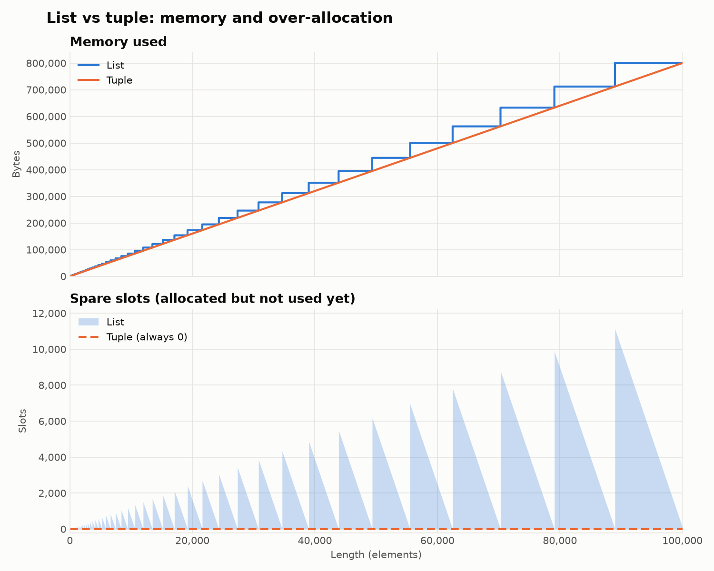

from idlelib.outwin import OutputWindow

## Introduction

Just like lists are dynamic arrays, tuples are static arrays in Python. This means that a size of a tuple is fixed. It 
cannot be resized after creation, like lists. 

**Prerequisite**: Please read the lesson in `1-lists` before reading this lesson as this lesson contains majority of
topics from that lesson.

### Internal representation of a tuple

Just like a list, a tuple object also stores pointers to its elements. Beyond that, a tuple also stores bookkeeping fields
like the length of the object, the type of the object, and so on, just like a list.

```python
import ctypes

t = (1, "test", 2.5)
read = lambda offset: ctypes.c_ssize_t.from_address(id(t) + offset).value   # 8 bytes at id(t) + offset

print(f"refcount @ {hex(id(t) + 0)}: {read(0)}")
print(f"type     @ {hex(id(t) + 8)}: {hex(read(8))}  id(tuple) = {hex(id(tuple))}")
print(f"length   @ {hex(id(t) + 16)}: {read(16)}  len(t) = {len(t)}")
print(f"hash     @ {hex(id(t) + 24)}: {read(24)}  hash(t) = {hash(t)}")
for i in range(len(t)):
    offset = 32 + i * 8
    print(f"slot {i}   @ {hex(id(t) + offset)}: {hex(read(offset))}  id(t[{i}]) = {hex(id(t[i]))}")

# Output
# refcount @ 0x102df6980: 2
# type     @ 0x102df6988: 0x103962620  id(tuple) = 0x103962620
# length   @ 0x102df6990: 3  len(t) = 3
# hash     @ 0x102df6998: 1758555752467964434  hash(t) = 1758555752467964434
# slot 0   @ 0x102df69a0: 0x103986318  id(t[0]) = 0x103986318
# slot 1   @ 0x102df69a8: 0x102c43a50  id(t[1]) = 0x102c43a50
# slot 2   @ 0x102df69b0: 0x102d18710  id(t[2]) = 0x102d18710
```
From the code above, we can clearly see that the tuple object also stores similar bookkeeping fields as a `list`. The
difference is in the `hash` field stored at address `0x102df6998`. For a `list`, this exact address (at 24 byte offset) 
stores the pointer to the array which contains the memory addresses of where the list elements are stored. A `list` object needs to 
store this because during a resize + move operation of a list, this address can change and the array which stores memory
addresses of elements can move to a different memory address altogether. That's not an issue for tuples because tuples
are immutable by nature.

### Memory Allocation

A tuple is extremely efficient when it comes to memory allocation in comparison to a `list`. We saw how a `list` overallocates
memory to optimize for the resize + move operation. But a tuple doesn't need to worry about resizing at all. It never 
overallocates capacity and only reserves the memory necessary to store all its elements. This is evident from the graph below:



One could argue that for a list of 90K elements, the overallocation for a `list` is just by ~100K bytes which is 0.1MB. 
In modern machines, this overage is negligible. But this quickly adds up when you are writing performant code and storing
long lists or tuples in memory, especially related to use cases involving huge amounts of data.

### Memory Caching

Python performs automatic garbage collection, meaning that when the reference count (stored at 0th byte for both `list` and `tuple`)
becomes 0, Python frees up that memory block. However, Python doesn't free up the allocated memory for tuples of sizes 0-20. 
The reason for that is when you now need to create a new tuple, you don't need to ask the operating system for memory. 
Python has already cached that memory for you and you can reserve it quickly for a new tuple.

```python
import sys

def reuse_test(make, block_size):
    a = make()
    old = id(a)
    del a                                                    # refcount -> 0, memory released
    other = b"\0" * (block_size - sys.getsizeof(b""))       # another object asks for a same-size block
    b = make()
    return id(b) == old, id(other) == old - 16               # block starts 16 bytes before id(): the GC header

for n in (1, 5, 20, 21, 30):
    t, other = reuse_test(lambda: tuple(range(n)), sys.getsizeof(tuple(range(n))))
    print(f"tuple, {n:>4} items: new tuple got old address = {t!s:<5}  other object got it = {other}")

for n in (5, 1000):
    t, other = reuse_test(lambda: [i for i in range(n)], sys.getsizeof([]))
    print(f"list,  {n:>4} items: new list  got old address = {t!s:<5}  other object got it = {other}")

# Output
# tuple,    1 items: new tuple got old address = True   other object got it = False
# tuple,    5 items: new tuple got old address = True   other object got it = False
# tuple,   20 items: new tuple got old address = True   other object got it = False
# tuple,   21 items: new tuple got old address = False  other object got it = True
# tuple,   30 items: new tuple got old address = False  other object got it = True
# list,     5 items: new list  got old address = True   other object got it = False
# list,  1000 items: new list  got old address = True   other object got it = False
```
The code above tries to create a tuple first of different sizes 
